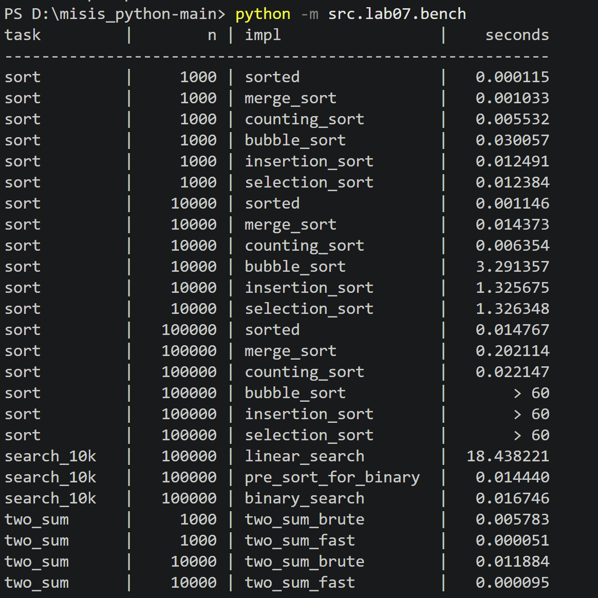
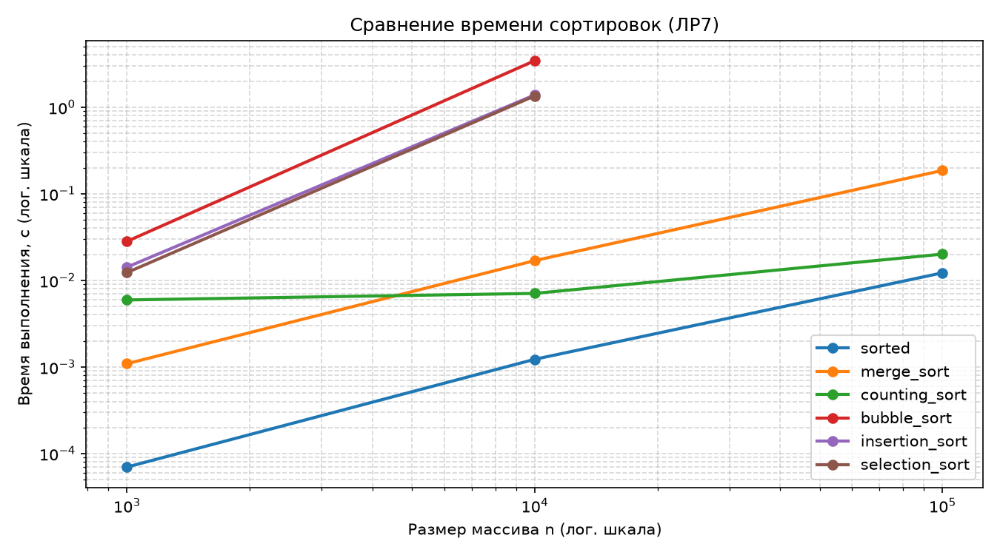

# misis_python
# Лабораторная работа №7

## Структура проекта
- `src/lab07/search.py` — реализации линейного (`linear_search`) и бинарного (`binary_search`) поиска.
- `src/lab07/sorting.py` — реализации алгоритмов сортировки (пузырьковая сортировка `bubble_sort`, сортировка вставками `insertion_sort`, сортировка выбором `selection_sort`, быстрая сортировка `quick_sort` / сортировка слиянием `merge_sort`).
- `src/lab07/check.py` — набор автоматических проверок корректности (814 тестов на граничных, пустых, отсортированных, обратно отсортированных и случайных массивах).
- `src/lab07/bench.py` — скрипт для замера времени выполнения алгоритмов и сохранения результатов в CSV.
- `data/lab07/bench.csv` — таблица с результатами замеров времени выполнения.

---

## Описание реализованных функций

### 1. Алгоритмы поиска (`src/lab07/search.py`)
- `linear_search(arr, target) -> int`  
  Последовательно перебирает элементы списка слева направо и возвращает индекс первого вхождения `target` или `-1`, если элемент не найден. Работает на любых (в том числе неотсортированных) списках.
- `binary_search(arr, target) -> int`  
  Выполняет поиск в **отсортированном** по неубыванию списке путём многократного деления диапазона поиска пополам с помощью двух указателей (`left` и `right`). На каждом шаге сравнивает `arr[mid]` с `target` и сдвигает границы (`left = mid + 1` или `right = mid - 1`), пока `left <= right`. Если элемент отсутствует, возвращает `-1`.

### 2. Алгоритмы сортировки (`src/lab07/sorting.py`)
- `bubble_sort(arr) -> list`  
  Попарно сравнивает соседние элементы и меняет их местами, если они стоят в неверном порядке, «всплывая» максимальный элемент в конец массива на каждой итерации. Использует флаг `swapped` для досрочного завершения на уже отсортированном списке.
- `insertion_sort(arr) -> list`  
  Поочерёдно берёт элементы из неотсортированной части и вставляет их на нужную позицию в уже отсортированную левую часть путём сдвига больших элементов вправо.
- `selection_sort(arr) -> list`  
  На каждом шаге находит минимальный элемент в оставшейся неотсортированной части списка и меняет его местами с первым элементом этой части.
- `quick_sort(arr) -> list` / `merge_sort(arr) -> list`  
  Рекурсивные алгоритмы стратегии «разделяй и властвуй» со средней асимптотикой $O(n \log n)$.

---

## Теоретическая сложность алгоритмов

| Алгоритм | Лучший случай | Средний случай | Худший случай | Доп. память | Требование к данным |
| :--- | :---: | :---: | :---: | :---: | :--- |
| `linear_search` | $O(1)$ | $O(n)$ | $O(n)$ | $O(1)$ | Не требуется |
| `binary_search` | $O(1)$ | $O(\log n)$ | $O(\log n)$ | $O(1)$ | Список должен быть отсортирован |
| `bubble_sort` (с флагом) | $O(n)$ | $O(n^2)$ | $O(n^2)$ | $O(1)$ | Не требуется |
| `insertion_sort` | $O(n)$ | $O(n^2)$ | $O(n^2)$ | $O(1)$ | Не требуется |
| `selection_sort` | $O(n^2)$ | $O(n^2)$ | $O(n^2)$ | $O(1)$ | Не требуется |
| `quick_sort` | $O(n \log n)$ | $O(n \log n)$ | $O(n^2)$ | $O(\log n)$ | Не требуется |
| `merge_sort` | $O(n \log n)$ | $O(n \log n)$ | $O(n \log n)$ | $O(n)$ | Не требуется |

---

## Примеры запуска

```python
from src.lab07.search import linear_search, binary_search
from src.lab07.sorting import bubble_sort, insertion_sort, quick_sort

data = [42, 7, 19, 3, 88, 15]

# Сортировка
sorted_data = insertion_sort(data.copy())
print("Отсортированный список:", sorted_data)  # [3, 7, 15, 19, 42, 88]

# Поиск
print("Линейный поиск 19:", linear_search(data, 19))          # 2
print("Бинарный поиск 19:", binary_search(sorted_data, 19))   # 3
print("Бинарный поиск 100:", binary_search(sorted_data, 100)) # -1
```

## Результаты проверки и графики


### bench таблицей через консоль



### bench графиком


