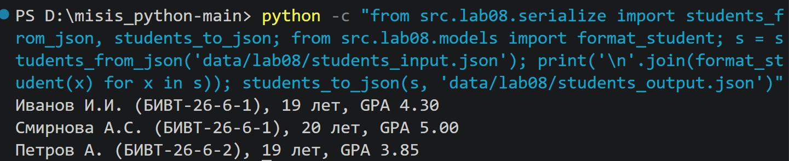
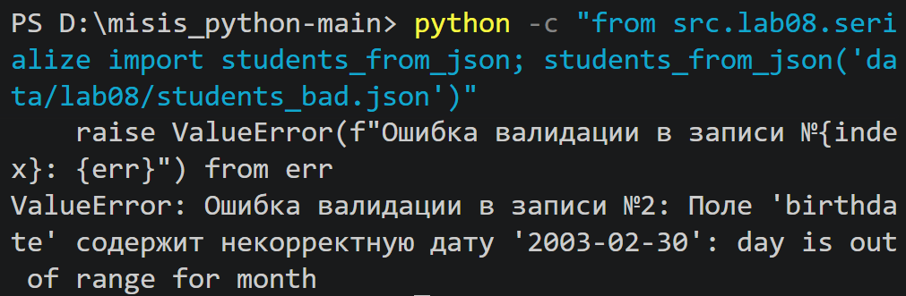
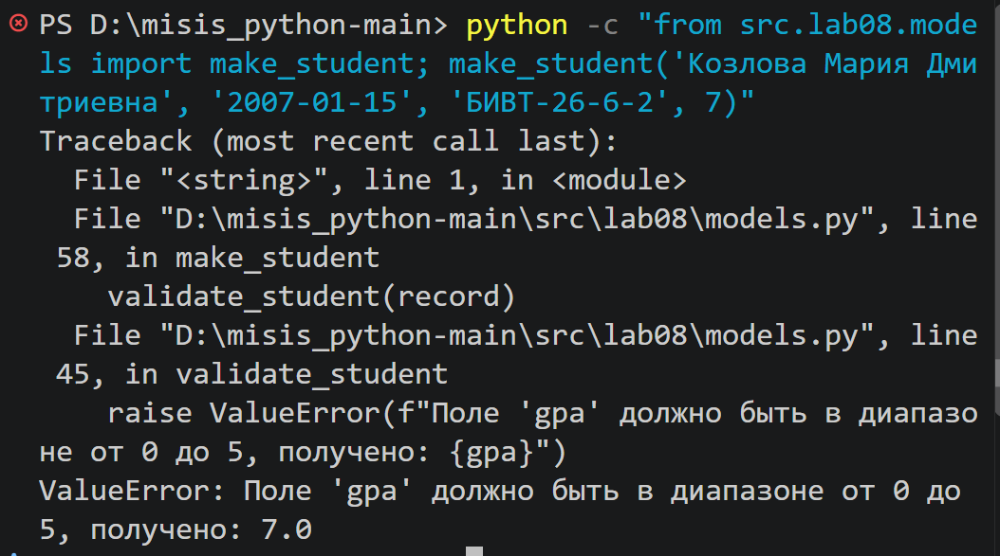

# Лабораторная работа № 8 — Модель данных без классов: запись Student как словарь, валидация и сериализация

## Описание модели `Student`
Модель реализована в виде словаря с фиксированным набором ключей `STUDENT_FIELDS = ("fio", "birthdate", "group", "gpa")`:
- `fio` (`str`) — ФИО студента, непустая строка;
- `birthdate` (`str`) — дата рождения в формате ISO `YYYY-MM-DD`, проверяется на календарное существование (`date.fromisoformat`) и отсутствие дат из будущего;
- `group` (`str`) — учебная группа, непустая строка;
- `gpa` (`float`) — средний балл в диапазоне `0 <= gpa <= 5` (целые числа приводятся к `float`, булевы значения `bool` отклоняются).

## Описание функций

### `src/lab08/models.py`
- `validate_student(rec)` — проверяет тип объекта (`dict`), точное совпадение набора ключей с `STUDENT_FIELDS` и корректность значений каждого поля; при нарушении выбрасывает `ValueError`.
- `make_student(fio, birthdate, group, gpa)` — конструктор записи: нормализует строковые поля (`.strip()`), приводит `int` к `float` и проверяет словарь через `validate_student`.
- `student_age(rec, today=None)` — вычисляет количество полных лет на дату `today` (по умолчанию `date.today()`), учитывая, наступил ли день рождения в текущем году.
- `format_student(rec)` — формирует строку вида `Иванов И.И. (БИВТ-26-6-1), 19 лет, GPA 4.30`.
- `student_to_dict(rec)` — возвращает валидированную копию словаря для защиты исходных данных от мутаций по ссылке.
- `student_from_dict(d)` — десериализует словарь, приводит `gpa` к `float` и запускает `validate_student`.

### `src/lab08/serialize.py`
- `students_to_json(students, path)` — валидирует список записей и сохраняет его в JSON-файл (`ensure_ascii=False`, `indent=2`).
- `students_from_json(path)` — загружает список словарей из JSON и пропускает каждую запись через `student_from_dict`.

## Политика обработки битых записей
В функции `students_from_json` выбрана политика **`strict`**: при обнаружении первой некорректной записи выполнение прерывается исключением `ValueError` с указанием порядкового номера записи в файле и конкретной причины ошибки.

## Примеры запуска

```python
from datetime import date
from src.lab08.models import make_student, student_age, format_student
from src.lab08.serialize import students_from_json, students_to_json

# 1. Загрузка корректного списка и сохранение в выходной JSON
students = students_from_json("data/lab08/students_input.json")
for s in students:
    print(format_student(s))

students_to_json(students, "data/lab08/students_output.json")



# 2. Проверка возраста на конкретную дату
s_bday = make_student("Петров Алексей", "2007-09-20", "БИВТ-26-6-2", 3.85)
print(student_age(s_bday, today=date(2026, 9, 19)))  # 18
print(student_age(s_bday, today=date(2026, 9, 20)))  # 19

# 3. Обработка битых записей (политика strict)
students_from_json("data/lab08/students_bad.json")
# ValueError: Ошибка валидации в записи №2: Поле 'birthdate' содержит некорректную дату '2003-02-30': day is out of range for month



## Обработка при gpa вне допустимого диапазона

